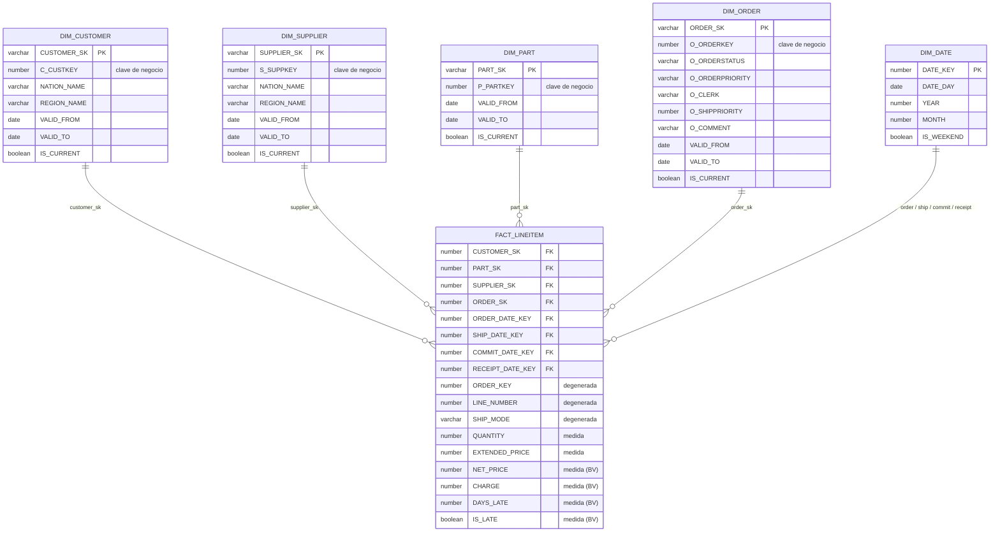

# Business Vault y mart dimensional

El Business Vault (`dbt/models/business_vault/`) y el mart (`dbt/models/mart/`) son **modelos SQL de dbt escritos a mano**, sin metadatos propios ni generador. Las dimensiones SCD2 comparten la macro `scd2_dimension`, y los hechos unen las dimensiones por fecha de vigencia con la macro `join_scd2`. Se diseñó así a propósito: cada hecho es una decisión de diseño distinta (grano, medidas, dimensiones), y expresarla en YAML equivalía a reescribir SQL en otro lenguaje.

```
RAW_VAULT ──► BUSINESS_VAULT ──► MART
 (15 objetos)   bsat_lineitem      dim_customer · dim_supplier · dim_part   (macro scd2_dimension)
                (vista)            dim_order                                 (macro scd2_dimension)
                                   fact_lineitem                             (SQL, macro join_scd2)
                                   dim_date                                  (calendario)
```

## Business Vault

Un único objeto, **virtual** (una vista en el esquema `BUSINESS_VAULT`):

| Objeto | Padre | Origen | Reglas |
|---|---|---|---|
| `bsat_lineitem` | `lnk_lineitem` | `sat_lnk_lineitem` | `net_price = extendedprice·(1−discount)`; `charge = net_price·(1+tax)`; `days_in_transit = receipt − ship`; `days_late = max(receipt − commit, 0)`; `is_late = receipt > commit` |

Una fila por cada versión del satélite origen. Son funciones puras de datos ya versionados, por eso es una vista: siempre es consistente y no hay nada que almacenar ni recargar.

**Qué no hay, y por qué:** no hay PIT porque cada hub tiene un solo satélite (la historia SCD2 se calcula directamente del satélite), ni bridge porque ninguna consulta lo justifica con este volumen.

Cambiar una regla es editar `dbt/models/business_vault/bsat_lineitem.sql`.

## Mart (esquema `MART`, tablas recalculadas en cada `dbt build`)



**Grano de `fact_lineitem`:** una fila por línea de pedido (1050 con los dos lotes).
**Sin hecho de pedidos.** No hay `fact_orders`: el importe total de un pedido (`O_TOTALPRICE`) no puede ir en `fact_lineitem` (se repetiría en cada línea y sumaría de más), pero tampoco hace falta exponerlo, porque es la suma del cargo (`CHARGE`) de sus líneas. Con los datos se comprobó que los 210 pedidos tienen líneas y que la diferencia máxima entre `O_TOTALPRICE` y la suma del cargo de sus líneas es de 0,005 por pedido (redondeo). El número de pedidos sale de `COUNT(DISTINCT ORDER_KEY)` y sus atributos, de `dim_order`. Si un origen futuro trajera pedidos sin líneas, o importes que no están en las líneas (envío, ajustes), habría que recuperar un hecho de pedido.

### Decisiones fijadas

1. **SCD2 en customer, supplier, part y order.** Customer, supplier y part son las que cambian entre lotes; order se trata igual por uniformidad (el estado de un pedido evoluciona en la realidad), aunque en estos datos cada pedido tiene una sola versión. `nation` y `region` no tienen dimensión propia: su nombre se desnormaliza en `dim_customer` y `dim_supplier` (join directo por código a `ref_nation` y `ref_region`).
2. **Vigencia:** la primera versión de cada clave vale desde `1900-01-01`; cada versión vale hasta la `LOAD_DATETIME` de la siguiente, o `9999-12-31` si es la vigente (`IS_CURRENT`).
3. **Qué versión ve cada línea:** la vigente en el `LOAD_DATETIME` con que se cargó la línea (`VALID_FROM <= LOAD_DATETIME < VALID_TO`). Así las líneas del lote 202512 apuntan a la versión antigua de un cliente que cambió en 202601.
4. **Claves subrogadas:** `dbt_utils.generate_surrogate_key([<hash key>, valid_from])`.
5. **Atributos degenerados en `fact_lineitem`:** número de pedido y de línea, modos de envío y banderas de devolución y de línea. Los atributos del pedido (estado, prioridad, empleado, prioridad de envío, comentario) están en `dim_order`. No se ha creado una dimensión de envío para `ship_mode`, `ship_instruct` y las banderas: son pocos atributos de baja cardinalidad y se dejan en el hecho.
6. **`dim_date`:** calendario desde la fecha mínima a la máxima presente en el vault; el hecho lleva cuatro claves de fecha (pedido, envío, compromiso, recepción) contra la misma dimensión.
7. **Medidas y reglas** de negocio: salen del Business Vault; el hecho no recalcula nada.
8. **Fuera de alcance:** `fact_partsupp` (suministro por pieza y proveedor). `partsupp` (`lnk_partsupp` y `sat_lnk_partsupp`) es lo único del Raw Vault que el mart no usa: pertenece a otro proceso de negocio (compras e inventario) que pediría un hecho de foto periódica con otro grano, y las ventas ya recogen la relación pieza-proveedor en cada línea. Sigue disponible en el vault y se añadiría sin tocarlo.

### Límite técnico conocido

`dim_date` genera hasta 3660 días (unos 10 años) a partir de la fecha mínima. Si los datos abarcaran más, los tests `relationships` del hecho fallarían avisando de ello.

## Tests y verificación

El proyecto dbt tiene 30 modelos (8 de staging, 15 del Raw Vault, 1 del Business Vault y 6 del mart) y 90 tests; `dbt build` los ejecuta todos. Los del mart y del Business Vault:

- `unique` y `not_null` en cada clave subrogada y en cada hash key.
- Sin solapes ni huecos entre versiones de una misma clave (`dbt_utils.mutually_exclusive_ranges`) y una sola versión vigente por clave.
- Grano único (`LINEITEM_HK` en `fact_lineitem`) y mismo número de filas que su origen (`lnk_lineitem`), para que no se pierda ningún registro al resolver dimensiones.
- Todas las claves del hecho existen en su dimensión.
- `bsat_lineitem` tiene el mismo número de filas que `sat_lnk_lineitem`.

Además se comprobó con un cálculo **independiente desde los CSV** (sin usar nada de lo calculado por dbt):

| Comprobación | Resultado |
|---|---|
| `dim_customer` / `dim_supplier` / `dim_part` | 25 / 18 / 46 versiones; 22 / 16 / 43 vigentes |
| `fact_lineitem` | 1050 filas |
| `SUM(extended_price)`, `SUM(net_price)`, `SUM(charge)` | iguales a los CSV (6 739 842,01 / 6 409 388,7151 / 7 358 018,261263) |
| `SUM(days_in_transit)`, `SUM(days_late)`, `COUNT(is_late)` | 6303 / 6947 / 1034, iguales a los CSV |
| Líneas del lote 202512 que apuntan a una versión antigua | customer 75, supplier 60, part 32, igual al esperado desde los CSV |
| Nación y región en dimensiones | correctas para todas las claves vigentes |
| `dim_date` | exactamente el rango de fechas de los datos (80 días) |
| `dim_order` | 210 pedidos (210 vigentes); atributos idénticos a los CSV |
| Pedidos distintos en `fact_lineitem` | 210: todos los pedidos tienen líneas |
| `SUM(charge)` frente a `SUM(o_totalprice)` de los CSV | 7 358 018,26 frente a 7 358 018,31: la diferencia es el redondeo por línea |

## Cómo ejecutarlo

Lo normal es lanzar el DAG `dv_end_to_end` de Airflow con el periodo (ver [orquestacion.md](orquestacion.md)): carga el lote y reconstruye las cuatro capas en orden. Para ejecutar solo dbt, dentro del contenedor:

```
cd /opt/dbt
dbt build                                   # todas las capas
dbt build --select business_vault mart      # solo Business Vault y mart (recalculables desde el Raw Vault)
```

El mart se recalcula completo en cada ejecución; la historia está en el Raw Vault, así que reconstruirlo no pierde nada.
