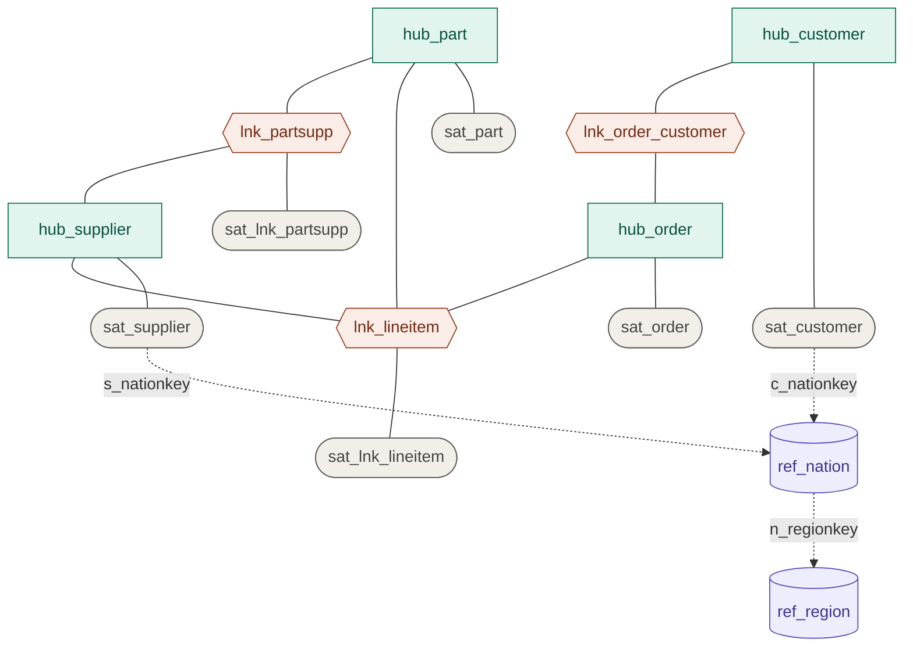

# Modelo del Raw Vault

Fuente de verdad: [`metadata/vault/vault.yml`](../metadata/vault/vault.yml). Los modelos dbt se generan con `dbt/scripts/generate_models.py`.

**15 objetos:** 4 hubs, 3 links, 6 satélites y 2 reference tables (`nation` y `region`, ver [decision_reference_tables.md](decision_reference_tables.md)).

Las líneas punteadas no son links: son un código (atributo) que se resuelve contra la tabla de referencia por su valor, sin hash key.

| Objeto | Clave | Notas |
|---|---|---|
| `hub_*` | `<ENTIDAD>_HK` (MD5 de la clave de negocio) | `hub_order` sale de `orders` |
| `lnk_*` | `<A>_<B>_HK` (MD5 de las claves unidas) | `lnk_lineitem` añade `L_LINENUMBER` como clave hija |
| `sat_*` | `<padre>_HK` + `LOAD_DATETIME` | nueva fila solo si cambia el `HASHDIFF`; `sat_customer` y `sat_supplier` incluyen el código de nación como atributo |
| `ref_*` | código natural (`N_NATIONKEY`, `R_REGIONKEY`) | sin hash; conserva la primera versión de cada código |

`partsupp` y `lineitem` no tienen hub propio: son links con satélite.

**Cómo se genera:** staging y Raw Vault se regeneran desde `vault.yml` en cada ejecución del DAG (etapa `generate_models`); los ficheros de `dbt/models/staging` y `dbt/models/raw_vault` son 100 % generados, no se editan a mano.

**Cada hub se carga desde una sola entidad:** `hub_nation` no existe, pero p. ej. `hub_customer` solo ve los clientes de `customer.csv`. Una clave que apareciera únicamente como referencia en otra entidad (un `o_custkey` sin cliente) no entraría en el hub. Con estos datos no ocurre (se comprobó que no hay claves huérfanas); con otros, el hub debería cargarse desde todas las fuentes que traen la clave.
